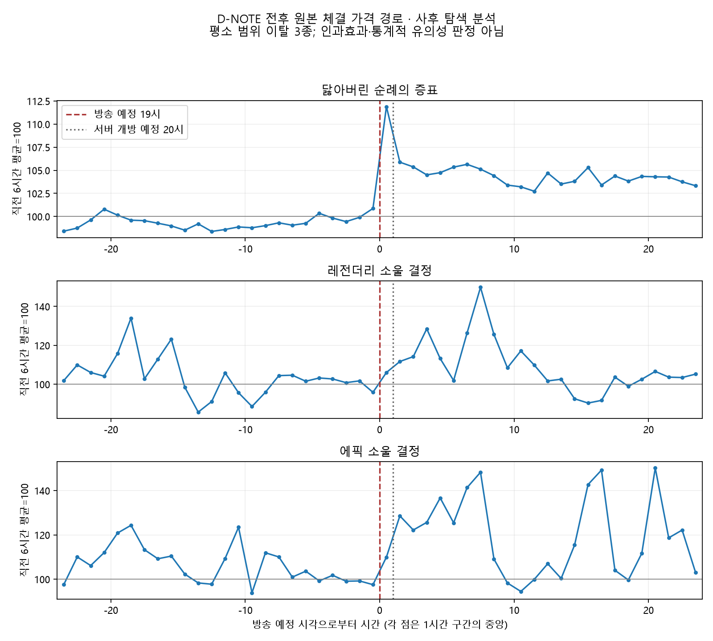

# D-NOTE 시간봉 탐색 분석 결과

분석일: 2026-11-03. [계산 전 고정한 탐색 규칙](d-note-event-analysis-plan-2026-11-03.md). 사후 설계이므로 사전 등록 연구가 아니다.

공식 공지상 10-27 19시 방송 예정, 20시 퍼스트 서버 개방이다. 실제 발언 시각을 검증하지 않았으며 6·24시간 결과는 두 사건이 함께 포함된다. [공식 출처](https://df.nexon.com/community/news/notice/2928724).

## 핵심 결과

- 1시간 창: 38종 중 비교 가능 12종, 평소 범위 밖 2종 (닳아버린 순례의 증표, 레전더리 소울 결정).
- 6시간 창: 38종 중 비교 가능 12종, 평소 범위 밖 3종 (닳아버린 순례의 증표, 레전더리 소울 결정, 에픽 소울 결정).
- 24시간 창: 38종 중 비교 가능 0종, 평소 범위 밖 0종 (없음).

주된 6시간 비교에서 범위 이탈은 평소 동일 시간대의 관측 움직임보다 이례적이라는 뜻이다. 여러 품목·창을 탐색했으며 신뢰구간·검정·다중검정 보정을 수행한 유의성 판정이 아니다. 따라서 방송의 인과효과나 '영향 없음'을 결론내릴 수 없다. 카드 34종은 호가 기반이므로 체결 분석에서 제외했다.

닳아버린 순례의 증표는 서버 개방 전 1시간에도 +11.89%로 참고 범위를 벗어났고, 직전 24시간을 기준으로 바꿔도 6시간 상승이 범위 밖이었다. 방송 시점과 맞물린 변화라는 관측 근거가 세 품목 중 상대적으로 일관된다. 다만 방송 내용·다른 공지·거래구성의 영향을 분해한 인과 증명은 아니다.

레전더리 소울은 6시간 기준 +13.37%이지만 직전 24시간 기준으로는 +4.91%이고 평소 범위 안이었다. 에픽 소울은 6시간 +26.18%지만 서버 개방 전 1시간의 +9.97%는 평소 범위 안이었다. 에픽의 24시간 기준 민감도 참고일은 19개로 최소 20개에 미달한다. 두 소울의 방송 단독 효과를 확정하지 않는다.

24시간 창은 실제 변화가 계산되는 품목도 있지만 모든 품목에서 유효 과거 비교일이 최소 20개에 미달했다. 시간 경로를 볼 수 있다는 것과 이례성을 평가할 표본이 충분하다는 것은 다르다.

## 38종 전체: 직전 6시간 대비 직후 6시간

가격은 원본 시간봉 수량 가중 평균 체결가다. 초과 변화는 실제 변화에서 과거 가상 사건 변화 중앙값을 뺀 퍼센트포인트. 거래량은 시간당 관측 수량 변화이며 전수 시장 거래량이 아니다. 모든 시간에 양의 체결 봉을 요구하므로 희소 품목은 자료 부족으로 남긴다. 결측 원인은 무거래와 수집 누락을 구분할 수 없다.

| 품목 | 가격 변화 % | 초과 변화 pp | 평소 5~95% 범위 | 참고일 | 수량 변화 % | 판정 |
|---|---:|---:|---:|---:|---:|---|
| 애니멀라이즈 언더웨어 아바타 세트 상자 | — | — | —~— | 0 | — | 자료 부족 |
| 프로스트의 전설 | — | — | —~— | 0 | — | 자료 부족 |
| 히스토리아 쿼츠 | — | — | -9.01~+8.23 | 5 | — | 자료 부족 |
| 닳아버린 순례의 증표 | +7.90 | +7.77 | -0.62~+1.76 | 23 | +161.08 | 평소 범위 밖(탐색) |
| 레전더리 소울 결정 | +13.37 | +12.03 | -5.19~+9.55 | 24 | +247.24 | 평소 범위 밖(탐색) |
| 열대야의 추억 오라 상자 | — | — | -1.70~+1.14 | 14 | — | 자료 부족 |
| 교환가능 레어 무기 클론 아바타 선택 상자 | — | — | —~— | 0 | — | 자료 부족 |
| 군자의 사계 | — | — | —~— | 0 | — | 자료 부족 |
| 천공의 지배자 | — | — | —~— | 0 | — | 자료 부족 |
| 숲속의 유랑악단 패키지 | — | — | -0.69~+0.76 | 12 | — | 자료 부족 |
| 숲속의 유랑악단 크리쳐 상자 | -0.06 | +0.14 | -1.09~+2.02 | 24 | +238.89 | 뚜렷한 이례성 증거 부족 |
| 숲속의 유랑악단 아바타 풀세트 상자 | — | — | -1.23~+1.51 | 9 | — | 자료 부족 |
| 숲속의 유랑악단 세라 상자 | — | — | -0.59~+2.19 | 4 | — | 자료 부족 |
| 숲속의 유랑악단 오라 상자 | — | — | -0.75~+1.99 | 18 | — | 자료 부족 |
| 숲속의 유랑악단 칭호 상자 | — | — | -0.88~+2.27 | 5 | — | 자료 부족 |
| 종이숲 디오라마 오라 상자 | — | — | —~— | 0 | — | 자료 부족 |
| 플로럴 스태그 알 | -0.14 | -0.05 | -0.92~+1.74 | 23 | +258.62 | 뚜렷한 이례성 증거 부족 |
| 플로럴 스태그 플래티넘 크리쳐 알 선택 상자 | — | — | -0.65~+0.19 | 10 | — | 자료 부족 |
| 종이달 오르골 칭호 선택 상자 | — | — | —~— | 0 | — | 자료 부족 |
| 광휘의 소울 결정 | -10.04 | -14.20 | -11.63~+13.18 | 23 | +44.86 | 뚜렷한 이례성 증거 부족 |
| 유니크 소울 결정 | +1.65 | +1.23 | -14.19~+20.09 | 23 | +76.52 | 뚜렷한 이례성 증거 부족 |
| 고대의 황금 증폭서 | — | — | —~— | 0 | — | 자료 부족 |
| 골드 코인 | +0.80 | +1.09 | -2.73~+2.08 | 24 | -3.90 | 뚜렷한 이례성 증거 부족 |
| 증폭 보호권 | — | — | -1.72~+1.79 | 22 | — | 자료 부족 |
| 실반 멜로디 카드 | -0.03 | -0.10 | -1.23~+0.79 | 12 | +961.90 | 자료 부족 |
| 레어 소울 결정 | +5.63 | +7.78 | -76.95~+13.29 | 21 | +86.21 | 뚜렷한 이례성 증거 부족 |
| 에픽 소울 결정 | +26.18 | +22.69 | -4.95~+13.88 | 24 | +598.11 | 평소 범위 밖(탐색) |
| 태초 소울 결정 | +3.00 | +2.11 | -5.28~+8.47 | 24 | +98.15 | 뚜렷한 이례성 증거 부족 |
| +10 장비 증폭권[골고라이언] | +0.04 | +0.12 | -1.97~+3.57 | 23 | +229.87 | 뚜렷한 이례성 증거 부족 |
| +11 장비 증폭권[골고라이언] | — | — | -0.67~+1.69 | 8 | — | 자료 부족 |
| +12 장비 증폭권[골고라이언] | — | — | —~— | 0 | — | 자료 부족 |
| +3 장비 증폭권[골고라이언] | — | — | —~— | 0 | — | 자료 부족 |
| +5 장비 증폭권[골고라이언] | — | — | —~— | 0 | — | 자료 부족 |
| +6 장비 증폭권[골고라이언] | — | — | —~— | 0 | — | 자료 부족 |
| +7 장비 증폭권[골고라이언] | -0.34 | -0.05 | -4.25~+1.87 | 17 | +188.64 | 자료 부족 |
| +8 장비 증폭권[골고라이언] | — | — | —~— | 0 | — | 자료 부족 |
| +9 장비 증폭권[골고라이언] | — | — | —~— | 0 | — | 자료 부족 |
| PC방 토큰 교환권 | +1.98 | +1.77 | -4.21~+3.92 | 24 | +185.78 | 뚜렷한 이례성 증거 부족 |

## 닳아버린 순례의 증표

| 직후 창 | 실제 변화 % | 초과 변화 pp | 평소 5~95% 범위 | 참고일 | 상태 |
|---|---:|---:|---:|---:|---|
| 1시간 | +11.89 | +11.81 | -1.77~+1.75 | 23 | 평소 범위 밖(탐색) |
| 6시간 | +7.90 | +7.77 | -0.62~+1.76 | 23 | 평소 범위 밖(탐색) |
| 24시간 | +6.12 | +6.39 | -1.75~+1.84 | 18 | 자료 부족 |

6시간 창 민감도. 화요일만 비교는 4개 수준의 기술적 비교이며 추론에 쓰지 않는다.

| 비교 규칙 | 실제 변화 % | 초과 변화 pp | 평소 범위 | 참고일 | 상태 |
|---|---:|---:|---:|---:|---|
| 직전 24시간 기준 | +8.42 | +8.57 | -1.11~+0.35 | 20 | 평소 범위 밖(탐색) |
| 목요일이 걸친 창 제외 | +7.90 | +7.80 | -0.67~+1.39 | 16 | 자료 부족 |
| 화요일만 | +7.90 | +7.66 | +0.12~+1.02 | 4 | 평소 범위 밖(탐색) |

## 레전더리 소울 결정

| 직후 창 | 실제 변화 % | 초과 변화 pp | 평소 5~95% 범위 | 참고일 | 상태 |
|---|---:|---:|---:|---:|---|
| 1시간 | +6.05 | +8.34 | -12.50~+3.91 | 24 | 평소 범위 밖(탐색) |
| 6시간 | +13.37 | +12.03 | -5.19~+9.55 | 24 | 평소 범위 밖(탐색) |
| 24시간 | +12.10 | +13.43 | -6.01~+8.84 | 19 | 자료 부족 |

6시간 창 민감도. 화요일만 비교는 4개 수준의 기술적 비교이며 추론에 쓰지 않는다.

| 비교 규칙 | 실제 변화 % | 초과 변화 pp | 평소 범위 | 참고일 | 상태 |
|---|---:|---:|---:|---:|---|
| 직전 24시간 기준 | +4.91 | +4.56 | -7.42~+10.52 | 20 | 뚜렷한 이례성 증거 부족 |
| 목요일이 걸친 창 제외 | +13.37 | +13.45 | -7.39~+9.71 | 16 | 자료 부족 |
| 화요일만 | +13.37 | +12.06 | -2.48~+2.98 | 4 | 평소 범위 밖(탐색) |

## 에픽 소울 결정

| 직후 창 | 실제 변화 % | 초과 변화 pp | 평소 5~95% 범위 | 참고일 | 상태 |
|---|---:|---:|---:|---:|---|
| 1시간 | +9.97 | +10.73 | -10.46~+12.48 | 24 | 뚜렷한 이례성 증거 부족 |
| 6시간 | +26.18 | +22.69 | -4.95~+13.88 | 24 | 평소 범위 밖(탐색) |
| 24시간 | +28.16 | +28.03 | -7.28~+12.08 | 18 | 자료 부족 |

6시간 창 민감도. 화요일만 비교는 4개 수준의 기술적 비교이며 추론에 쓰지 않는다.

| 비교 규칙 | 실제 변화 % | 초과 변화 pp | 평소 범위 | 참고일 | 상태 |
|---|---:|---:|---:|---:|---|
| 직전 24시간 기준 | +14.70 | +14.72 | -7.84~+11.69 | 19 | 자료 부족 |
| 목요일이 걸친 창 제외 | +26.18 | +22.39 | -5.33~+14.78 | 16 | 자료 부족 |
| 화요일만 | +26.18 | +22.94 | -2.66~+5.17 | 4 | 평소 범위 밖(탐색) |

## 해석의 한계

- 비교일은 공지 이전의 매일 19시다. 모두 동일 요일이 아니며 추세·다른 사건·시간대 거래구성 변화가 섞여 있다. 목요일 제외와 화요일만의 결과를 함께 보되 적은 참고일로 유의성을 주장하지 않는다.
+- 원본 체결 시간봉을 사용했다. 화면의 정제 일봉과 수치가 다를 수 있다. raw_complete는 보존 중 원본과의 집계 경계 상태이지 API 완전 포착 인증이 아니다. 과거 원본 삭제로 false인 봉도 그대로 보존했다.
+- 비교 가능 품목은 활발한 거래 종목으로 치우친다. 전체 시장 대표값이나 38종 전체의 평균 효과로 일반화하지 않는다.
+- 관측된 거래 수량 급증은 수집 응답 포화의 영향을 받을 수 있다. 과거 collection_runs 7일 보존 때문에 전체 참고기간의 포착률을 이 입력만으로 재검증하지 못했다.
+- 공지 뒤~방송 전 기대 반영, 방송 내용별 발언 시각, 서버 개방 이후의 영향을 분해하지 않았다. 발표 내용을 반영한 수혜/피해 분류도 결과를 보고 소급 지정하지 않는다.

## 재현과 보존

- 운영 main: `d58811a6145894f9edd35f757a085fd09c4f31fd`
+- 보고서 생성 코드 커밋: b6ffba8ffd8bbba64dee47a77f6b714526e46756
- 입력 확보/계산 함수 커밋: `bcce4aaa84fb553d36eb90380691a60dd57b19e2`
+- 입력 구간: 2026-09-28T10:00:00Z 이상 ~ 2026-10-28T10:00:00Z 미만 (KST 09-28 19시~10-28 19시).
+- DB 기준: hist_b: read_at=2026-11-03T10:11:22.626Z, refreshed_at=2026-11-03T10:02:07.354Z, raw_max_id=24969673; hist_c: read_at=2026-11-03T10:11:23.355Z, refreshed_at=2026-11-03T10:02:15.754Z, raw_max_id=17408723
+- 입력 gzip SHA-256: `4005460d4a36be88d67c30da1cab88c926480a42ea281833cc9a2938c5713781`
+- 압축 전 JSON SHA-256: `d9c9f13ac6784d5ad22dbeb6be317cc069d392ee2d19627f8c0df126397839e2`
+- 입력·공개 summary·모든 비교일/시간경로/민감도 결과는 [evidence/d-note-20261103](evidence/d-note-20261103)에 보존. 파일별 해시는 manifest.json.
+- 재계산: `node scripts/d-note-event-study.ts docs/evidence/d-note-20261103`
+- 그림: `python scripts/plot-d-note-study.py`
+- 운영 DB는 읽기 전용 트랜잭션만 사용했다. 정기 수집·R2·모델·분석 규칙·사이트 배포는 변경하지 않았다.
